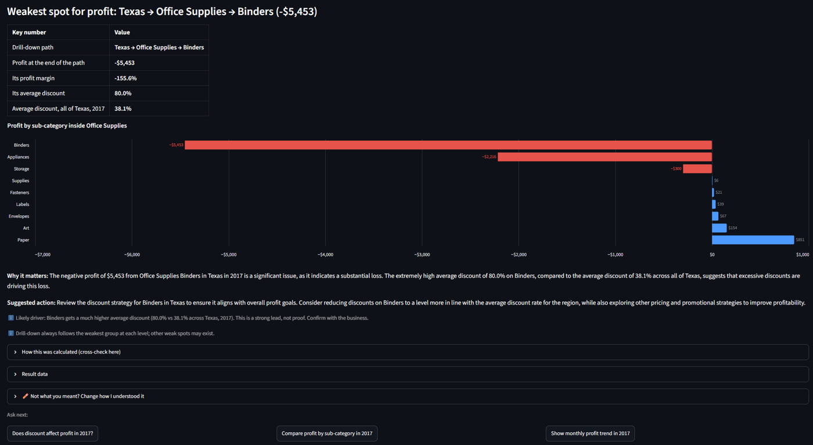
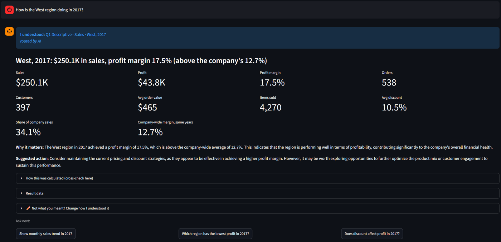
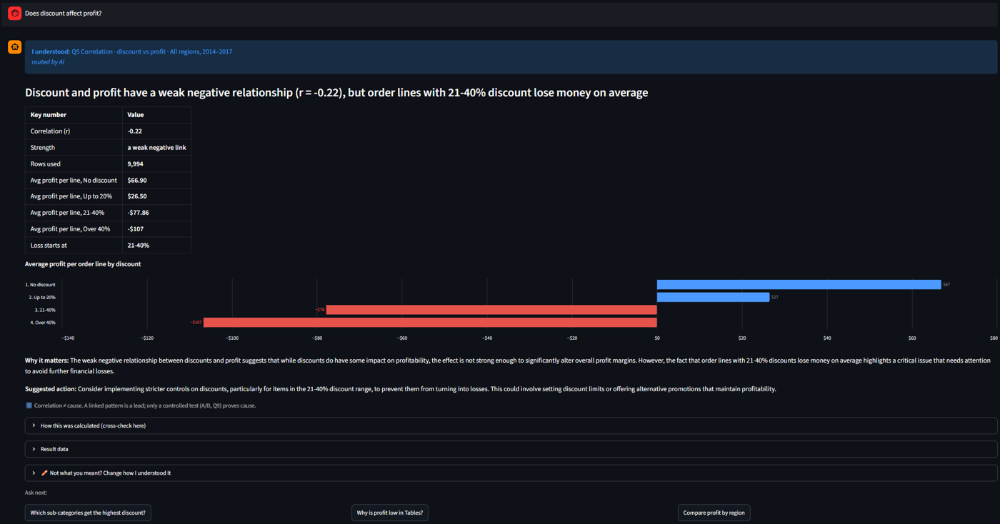

# Superstore AI Analyst

Ask business questions about the Superstore sales data in plain English. A local AI model
(via Ollama, free, no API key) decides **what type of question** it is, then **fixed methods in code**
do the analysis, so the numbers are always calculated, never guessed.

**Results:** 46/46 recipe checks · 32/32 end-to-end questions with the real model (v1.0) · every answer shows its SQL.

## See it work


https://github.com/user-attachments/assets/b292ffb2-0019-445d-8f2a-0b026b260292


**"Why is profit low in Texas in 2017?"** drills down region → category → sub-category and finds the cause:


**"How is the West region doing in 2017?"** gives a health check with a company benchmark:


**"Does discount affect profit?"** shows a correlation plus discount bands showing where losses start:


## How it answers

```
Question
  → 1. Understand (AI)  picks the question type (Q1–Q10) and fills a fixed form
                        (few-shot examples; asks back if the question is too vague)
  → 2. Confirm (you)    "I understood: Q3 Comparison · Profit · by region…" — one-click edit if wrong
  → 3. Compute (code)   that type's fixed method as SQL + Python maths; chart chosen by type
  → 4. Explain (AI)     explains the code's numbers in plain English (no new numbers allowed)
  → 5. Verify (you)     the exact SQL is shown under "How this was calculated"
```

| Type | Example question | Method |
|---|---|---|
| Q1 Descriptive | Total sales and profit in 2017 | SUM, COUNT DISTINCT, ratios |
| Q2 Trend | Show monthly sales | GROUP BY period + MoM / YoY % |
| Q3 Comparison | Which region has the lowest profit? | GROUP BY + rank |
| Q4 Diagnostic | Why is profit low in the Central region? | Drill-down: weakest group at each level |
| Q5 Correlation | Does discount affect profit? | Correlation + discount bands |
| Q6 Segmentation | Who are our best customers? | RFM scores → segments |
| Q7 Funnel | — | Not possible: no step data in Superstore |
| Q8 Cohort | Do customers come back? | First-purchase quarter → return rate |
| Q9 Experiment | — | Not possible: no A/B groups in Superstore |
| Q10 Forecast | Forecast sales for the next 3 months | Same month last year × growth, with backtest |

## Why it's built this way

The first version let the AI write all SQL and explanations. Testing showed it wrote good SQL but
**miscalculated percentages** in its explanations (e.g. calling a 29% drop "slight").
So in this version:
- all maths happens in code,
- the AI only classifies questions and puts finished numbers into words,
- every answer shows the SQL so a person can verify it.

## Tested like a real release

1. **Recipe tests** (`test_recipes.py`): every method checked against numbers verified by hand in SQL.
2. **Evaluation suite** (`evaluate.py`): real questions through the real model. It checks question type,
   filters, calculation, and that the explanation uses no invented numbers.
3. **User testing**: questions typed freely, in new wording. Each bug found became a new test before it was fixed:

| Question | Bug found | Fix |
|---|---|---|
| Which state lost the most money in 2017? | "Losing money" counted only the rows shown (1), not all states (9 of 47) | Count across all groups |
| Why is profit low in Texas? | Drill-down stopped because a state sits in one region; % change on losses showed -30,376% | Skip single-value levels; show $ change for losses |
| How is the Consumer segment doing? | Treated as a ranking with an invented "top 1"; AI called 31% "the majority" | Health-check rule + benchmark; wording rules |
| Forecast profit for the next 6 months | Confident headline despite 145% backtest error | "Rough estimate only" + N-month total |
| Show quarterly profit for Furniture | AI read a year-on-year *change* (-$4,478) as the quarter's profit (-$974) | Labels say "a change, not the value" |

## Run it

Needs: Python, [Ollama](https://ollama.com) with the model downloaded.

```
ollama pull qwen2.5-coder:14b
python -m pip install -r requirements.txt
python -m streamlit run app.py
```

Put `Sample - Superstore.csv` (Kaggle Superstore dataset) in the same folder.

Two test suites:
```
python test_recipes.py     # 46 checks: every recipe vs numbers verified by hand in SQL (no AI needed)
python evaluate.py         # 34 real questions through the real AI: question type, filters,
                           # calculation, and "no invented numbers" in the explanation
```
`evaluate.py` writes `eval_report.md` with the score per question type and every failure.

## Files

| File | Job |
|---|---|
| `app.py` | Web page (Streamlit chat, confirm/edit step) |
| `pipeline.py` | Question → understand → compute → explain (shared by app and tests) |
| `evaluate.py` | End-to-end test with the real AI model |
| `router.py` | Question type + form filling (AI, with keyword backup) |
| `recipes.py` | One method per question type (SQL + pandas) |
| `charts.py` | Chart per question type (Altair) |
| `narrator.py` | Plain-English explanation (AI) |
| `data.py` | Loads the CSV into SQLite; allowed columns |
| `fmt.py` | Number formatting |
| `business_notes.md` | Business context the AI reads |
| `test_recipes.py` | 46 checks against hand-verified SQL results |

## Limits

- Funnel and A/B questions need different data.
- Diagnostic drill-down follows the weakest group at each level; it finds a strong lead, not proof of cause.
- Forecasts are estimates (backtest error is shown with every forecast).
- Questions outside the 10 types fall back to AI-written SQL, which is clearly marked for checking.
